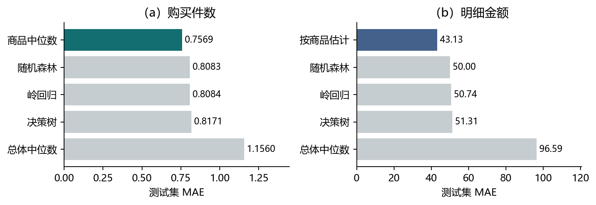

# 机器学习课程设计 · 实验一

本项目研究烘焙订单明细的购买件数与结账金额预测，完成数据清洗、回归模型比较、参数优化、特征工程和独立测试。实验比较岭回归、决策树、随机森林与中位数方法，使用 MAE、RMSE 和 R² 评价结果。

仓库附有原始数据、可运行源码、实验结果和 6 页 Word 报告。报告首页列明四位组员的分工。

- [实验报告](projects/bakery-regression/实验1报告_烘焙订单回归.docx)
- [详细实验说明](projects/bakery-regression/README.md)
- [数据探索 Notebook](projects/bakery-regression/notebooks/01_data_exploration.ipynb)
- [测试集指标](projects/bakery-regression/outputs/metrics/test.csv)

## 下载与运行

使用 **Python 3.11（64 位）**。以下命令从 GitHub 下载完整实验分支，在仓库根目录安装依赖，然后运行训练与评估。

```text
git clone --branch feat/experiment-1-regression --single-branch https://github.com/Yinfelix/MachineLearning.git
cd MachineLearning
python -m pip install -r requirements.txt
cd projects/bakery-regression
python -m src.train
```

已有本地仓库时，在仓库根目录执行 `git fetch origin` 和 `git switch feat/experiment-1-regression`，再按上面的安装和训练命令运行。

训练完成后，终端显示测试指标，`projects/bakery-regression/outputs/metrics/` 保存结果表，`projects/bakery-regression/outputs/figures/` 保存图表。再次运行会重新生成这些结果。数据文件随仓库提供，安装依赖后即可在本地完成实验。

在 `projects/bakery-regression` 目录运行测试或单独生成数据审计。

```text
python -m unittest discover -s tests -v
python -m src.data_audit
```

中文图表使用系统字体，可选微软雅黑、苹方或思源黑体。Windows 虚拟环境与 Notebook 的运行命令见详细实验说明。

## 数据与实验设计

数据包含 19,321 条合成烘焙交易明细、40 个字段，覆盖 2023 至 2024 年的三家门店。每条记录对应订单中的一种商品，`Quantity` 是购买件数，`Total_Bill` 是该行商品的结账金额。发布者为 sdcloud，数据许可为 CC0。[数据集发布页](https://www.kaggle.com/datasets/sdcloud/historical-bakery-sales-dataset)

基础模型使用商品、顾客、价格、促销、日历、天气和门店等 23 项输入。缺失填补、标准化与独热编码在各训练折内拟合。

| 数据划分 | 日期范围 | 明细数 | 用途 |
| --- | --- | ---: | --- |
| 训练集 | 2023-01-01 至 2024-06-30 | 14,340 | 三折时序交叉验证与超参数选择 |
| 验证集 | 2024-07-01 至 2024-09-30 | 2,533 | 按 MAE 比较模型与特征方案 |
| 测试集 | 2024-10-01 至 2024-12-31 | 2,448 | 合并训练、验证数据重训后的最终评估 |

拓展实验比较时间周期、商品交互、互信息选列，以及移除或置换五组特征后的误差变化。随机种子为 42，依赖版本固定在 `requirements.txt` 中。

## 实验结果

下表汇总第四季度 2,448 条测试明细的表现。件数 MAE 的单位为件，金额 MAE 沿用数据集的计价单位。

| 方法 | 件数 MAE | 金额 MAE |
| --- | ---: | ---: |
| 总体中位数 | 1.1560 | 96.59 |
| 岭回归 | 0.8084 | 50.74 |
| 决策树 | 0.8171 | 51.31 |
| 随机森林 | 0.8083 | 50.00 |
| 按商品估计 | **0.7569** | **43.13** |

“按商品估计”先用历史商品中位数预测件数，再乘以当前折后单价估算金额。两项 MAE 相对总体中位数分别降低 34.5% 和 55.4%。直接回归金额的随机森林取得最低金额 RMSE，为 101.01。完整的三项指标见测试结果表。



## 项目目录

```text
MachineLearning/
├── README.md
├── requirements.txt
└── projects/
    ├── archive/data/bakery_sales_dataset.csv
    └── bakery-regression/
        ├── README.md
        ├── config.json
        ├── src/                 # 数据处理、建模、训练与绘图
        ├── tests/               # 数据、预处理与实验流程测试
        ├── notebooks/           # 数据探索
        ├── outputs/metrics/     # 参数搜索、验证、测试与逐条预测
        ├── outputs/figures/     # 分布、模型比较、预测和残差图
        └── 实验1报告_烘焙订单回归.docx
```

## 小组分工

| 姓名 | 学号 | 完成内容 |
| --- | --- | --- |
| 尹誉 | 2451313 | 核对原始字段与缺失值，划分数据，分析件数和金额分布 |
| 佟宇璇 | 2451311 | 实现岭回归与中位数模型，构建金额换算方法，核对逐条预测 |
| 张孙霖 | 2453854 | 训练决策树和随机森林，设计时序交叉验证，比较调参结果 |
| 蓝浩 | 2452057 | 构造时间与商品交互特征，完成特征筛选、消融和残差分析 |
