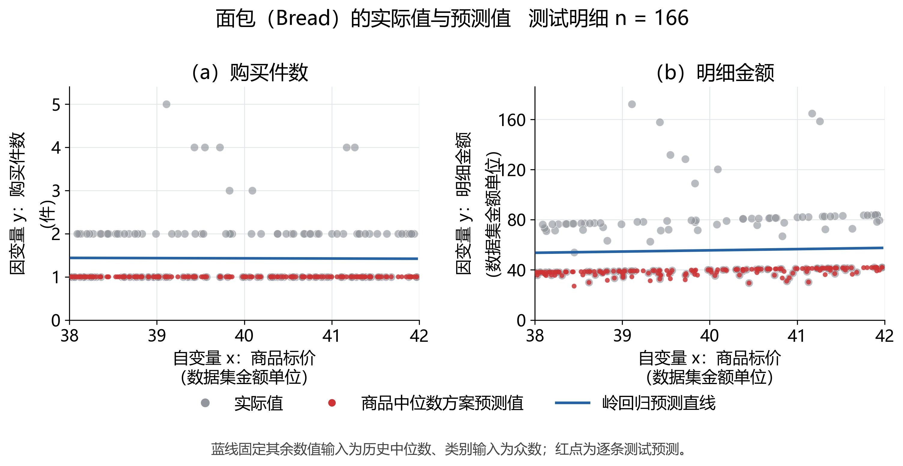

# 烘焙订单明细的购买件数与金额预测

一条样本对应订单中的一种商品。实验预测购买件数（`Quantity`）和该行商品的结账金额（`Total_Bill`），比较直接回归金额与“折后单价 × 预测件数”的效果。原始数据、代码、图表与报告共同组成实验一的提交内容。[实验报告](实验1报告_烘焙订单回归.docx)

## 环境与运行

使用 Python 3.11（64 位）。复现版本见[作业依赖](../requirements.txt)。

从仓库根目录开始运行。

```text
python -m pip install -r homework-01/requirements.txt
cd homework-01/bakery-regression
python -m src.train
```

该命令依次执行数据审计、基础模型比较、时序调参、特征实验、独立测试和绘图。终端显示最终指标，结果写入当前项目的 `outputs/`。再次运行会重新生成结果表和图表。

### Windows 虚拟环境

在仓库根目录打开 PowerShell，执行以下命令。

```powershell
py -3.11 -m venv .venv
.\.venv\Scripts\python.exe -m pip install -r .\homework-01\requirements.txt
cd .\homework-01\bakery-regression
..\..\.venv\Scripts\python.exe -m src.train
..\..\.venv\Scripts\python.exe -m unittest discover -s tests -v
```

中文图表使用系统中的微软雅黑、苹方、思源黑体或文泉驿微米黑。运行时使用 `src/models.py` 中的随机种子 42，随机森林固定 64 棵树并使用 4 个并行任务。

### 单独审计与测试

在本项目目录、使用同一 Python 环境运行。

```text
python -m src.data_audit
python -m unittest discover -s tests -v
```

审计结果写入 `outputs/metrics/data_audit.json`。26 项测试覆盖日期划分、订单分组、缺失填补、编码、特征生成、模型序列化和特征选择。

已有实验结果时，在本项目目录执行 `python -m src.plots`，可单独重绘实际值与预测值图。图中选取 166 条面包（Bread）测试明细，横轴为商品标价，纵轴分别为购买件数和明细金额。灰点表示实际值，红点表示保存的商品中位数方案逐条预测。

蓝线为岭回归预测直线：程序读取交叉验证选定的参数，在合并的训练集与验证集上重训模型，再让商品标价变化；其他数值输入固定为历史面包样本的中位数，类别输入固定为众数。

### 数据探索 Notebook

在本项目目录中，用运行实验的 Python 环境安装 Notebook 依赖并注册内核。执行命令中的内核名称与注册名称一致。

```text
python -m pip install ipykernel nbconvert
python -m ipykernel install --user --name bakery-regression --display-name "Python (bakery-regression)"
python -m nbconvert --to notebook --execute --inplace --ExecutePreprocessor.kernel_name=bakery-regression notebooks/01_data_exploration.ipynb
```

使用 VS Code 时，也可打开笔记并选择 `Python (bakery-regression)` 内核运行全部单元格。笔记生成 01、02 两张数据探索图。[数据探索笔记](notebooks/01_data_exploration.ipynb)

## 数据与预处理

随仓库提供的 CSV 含 19,321 条合成交易明细、40 个字段，涵盖 2023—2024 年的 35 种商品、500 位顾客和三家门店。数据由 sdcloud 发布，许可为 CC0。[原始 CSV](../archive/data/bakery_sales_dataset.csv) · [数据集发布页](https://www.kaggle.com/datasets/sdcloud/historical-bakery-sales-dataset)

基础输入包括商品、顾客、门店、标价、折扣、促销、日历和天气等 23 个字段，具体列名记录在 `config.json`。件数和金额分别作为预测目标，金额沿用数据集的计价单位。

- 数值列按训练中位数填补，岭回归使用标准化。
- 普通类别按训练众数填补并做独热编码。
- 会员、周末和促销状态编码为 0 或 1。
- 节日空值编码为 `Not Specified`，未促销记录的空促销类型编码为 `No Promotion`。
- 时间特征与商品交互由原始输入构造，预处理和互信息筛选在相应训练数据上拟合。

| 数据 | 日期范围 | 明细数 | 用途 |
| --- | --- | ---: | --- |
| 训练 | 2023-01-01 至 2024-06-30 | 14,340 | 按日期做三折扩展窗口验证，确定模型参数 |
| 验证 | 2024-07-01 至 2024-09-30 | 2,533 | 比较特征和模型，以 MAE 确定最终方案 |
| 测试 | 2024-10-01 至 2024-12-31 | 2,448 | 合并训练与验证数据重训后评估 |

同一天的订单进入同一交叉验证折，每折使用较早日期预测较晚日期。三个验证窗口分别始于 2023-05-20、2023-10-03 和 2024-02-16。

## 模型与参数选择

| 方法 | 实现 | 参数搜索 |
| --- | --- | --- |
| 总体中位数 | `DummyRegressor` | 训练目标的中位数 |
| 岭回归 | `Ridge` | `alpha = [0.1, 1, 10, 100]` |
| 决策树 | `DecisionTreeRegressor` | `max_depth = [4, 8, 12]`，`min_samples_leaf = [5, 30]` |
| 随机森林 | `RandomForestRegressor` | `max_depth = [5, 12]`，`min_samples_leaf = [2, 20]` |
| 商品中位数 | `ProductMedian` | 按商品计算训练集件数中位数 |

经典回归模型分别拟合件数和金额。按商品估计金额时，程序由标价和折扣计算折后单价并保留两位小数，再乘以预测件数。

每种回归模型按三折平均 MAE 选择参数。两项目标选出的岭回归 `alpha` 均为 10，决策树最大深度为 8、叶节点最少 30 条，随机森林最大深度为 12、叶节点最少 20 条。模型及特征方案随后在第三季度验证集比较，最终选择记录在 `selection.json`。

## 特征工程与分析

| 方案 | 特征构造 | 训练集编码列数 |
| --- | --- | ---: |
| 基础特征 | 23 个基础字段的填补和编码 | 103 |
| 日历特征 | 加入月、星期、小时的正余弦及日期趋势 | 110 |
| 商品交互 | 商品分别与季节、促销类型、周末和顾客分群组合 | 670 |
| 互信息筛选 | 在商品交互特征中按训练集互信息选列 | 10、20、40 |

件数实验在岭回归和随机森林上比较这些方案。另对顾客、日历、价格与促销、天气、商品五组字段做移除重训和验证集内的整组置换，观察 MAE 的变化。

金额分析以训练集金额第 90 百分位为分界，比较两组测试明细上的金额换算与随机森林误差。完整记录保存在 `groups.csv` 和 `amount_bands.csv`。

## 测试结果

MAE 为平均绝对误差，RMSE 为均方根误差，两者越低越好。R² 为决定系数，越接近 1 表示拟合越好。表中结果来自 2024 年第四季度的 2,448 条独立测试明细。

| 目标 | 方法 | MAE | RMSE | R² |
| --- | --- | ---: | ---: | ---: |
| 件数 | 总体中位数 | 1.1560 | 1.9289 | -0.0187 |
| 件数 | 岭回归 | 0.8084 | **1.2378** | **0.5805** |
| 件数 | 决策树 | 0.8171 | 1.2676 | 0.5601 |
| 件数 | 随机森林 | 0.8083 | 1.2472 | 0.5741 |
| 件数 | 商品中位数 | **0.7569** | 1.3396 | 0.5087 |
| 金额 | 总体中位数 | 96.59 | 188.72 | -0.1440 |
| 金额 | 岭回归 | 50.74 | 101.59 | 0.6685 |
| 金额 | 决策树 | 51.31 | 104.64 | 0.6483 |
| 金额 | 随机森林 | 50.00 | **101.01** | **0.6723** |
| 金额 | 折后单价 × 预测件数 | **43.13** | 111.29 | 0.6021 |

按验证集 MAE 选出的方案为商品中位数预测件数、再乘以折后单价估算金额。两项测试 MAE 相对总体中位数分别降低 34.5% 和 55.4%。[测试指标](outputs/metrics/test.csv) · [逐条预测](outputs/metrics/predictions.csv)



## 代码与输出

| 路径 | 内容 |
| --- | --- |
| `config.json`、`src/config.py` | 数据位置、输入字段、时间划分与缺失标签 |
| `src/dataset.py`、`src/data_audit.py` | 数据读取、清洗、时间划分和审计 |
| `src/preprocessing.py`、`src/features.py` | 填补、编码、周期、交互及互信息 |
| `src/models.py` | 模型、候选参数和评价指标 |
| `src/train.py` | 调参、选模、特征分析和独立测试 |
| `src/plots.py` | 根据实验结果绘图 |
| `outputs/metrics/data_audit.json` | 数据质量和时间划分统计 |
| `outputs/metrics/cv.csv` | 各组参数的三折 MAE 与选择结果 |
| `outputs/metrics/validation.csv`、`selection.json` | 各方案的验证指标与最终选择 |
| `outputs/metrics/test.csv`、`predictions.csv` | 测试指标与逐条真实值、预测值 |
| `outputs/metrics/feature_scores.csv`、`groups.csv` | 互信息排名与特征组实验 |
| `outputs/metrics/amount_bands.csv` | 按金额分组后的测试误差 |
| `outputs/figures/` | 01–02 为探索笔记图，03–07 为训练分布、测试 MAE、预测、残差和特征组对照图 |

结果表中，`median` 表示总体中位数，`product_median` 表示商品件数中位数，`price_x_quantity` 表示折后单价乘以预测件数。`ridge`、`tree`、`forest` 对应三种经典回归模型。`_initial` 为调参前，`_calendar` 和 `_cross` 为加入日历和商品交互，`_k` 后的数字为保留列数。

修改数据路径、字段或时间划分可编辑 `config.json`，修改参数搜索范围可编辑 `src/models.py` 中的 `GRIDS`，随后重新执行训练命令。
